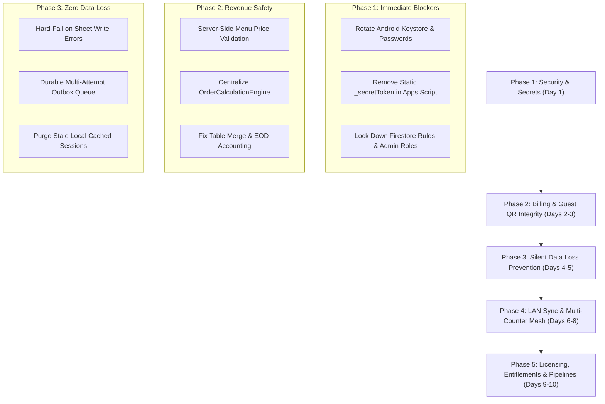

# 📋 SmartBizz POS — 190 Audit Points Catalog (28 Oct 2026)

> **Platform:** SmartBizz POS (Hospitality & Multi-Retail Unified Platform)  
> **Repository:** [`smart_restaurant_pos`](file:///c:/Users/santhosh/Downloads/smart_restaurant_pos) · [`smart_kirana_shop`](file:///c:/Users/santhosh/Downloads/smart_kirana_shop)  
> **Branch:** `develop` | **Version:** `1.3.0+57`  
> **Audit Date:** 28 October 2026 | **Classification:** 190 Total Issues (25 Critical, 55 High, 65 Medium, 45 Low)

---

## 📑 Domain Summary & Breakdown

| # | Domain Category | Total Issues | Critical (Sev 1) | High (Sev 2) | Medium (Sev 3) | Low (Sev 4) |
|---|---|:---:|:---:|:---:|:---:|:---:|
| **1** | **Security, Authentication & Access Control** | 38 | 9 | 12 | 11 | 6 |
| **2** | **Money, Billing Calculations & Financial Integrity** | 32 | 5 | 11 | 10 | 6 |
| **3** | **Data Persistence, Google Sheets & Outbox Sync** | 28 | 4 | 9 | 10 | 5 |
| **4** | **LAN Hub, Satellites & Multi-Counter Mesh** | 30 | 3 | 9 | 11 | 7 |
| **5** | **Licensing, Entitlements & Anti-Piracy** | 29 | 3 | 8 | 11 | 7 |
| **6** | **Code Quality, Testing & Deployment Pipelines** | 33 | 1 | 6 | 12 | 14 |
| | **TOTAL** | **190** | **25** | **55** | **65** | **45** |

---

## 🔐 Domain 1: Security, Authentication & Access Control (Issues 1–38)

### Critical & High Severity (Issues 1–21)
1. **CRITICAL - Leaked Android Upload Keystore in Git**: `android/app/upload-keystore.jks` and `android/key.properties` committed to GitHub repository. Rotate upload key on Play Console and scrub history.
2. **CRITICAL - Plaintext Keystore Passwords in Source**: `key.properties` contains plaintext store and key passwords. Move to secure external build environment variables.
3. **CRITICAL - Test Automation Environment Credentials Committed**: `test_automation/.env.test` exposes live test accounts, tokens, and admin emails. Remove from repository tracking.
4. **CRITICAL - Unencrypted Private Signing Key Mirrored to Cloud**: `claude_run.ps1` syncs `secrets/lease_signing_key.pem` unencrypted to Google Drive (`SmartBizz_Production_Vault`). Encrypt vault before cloud sync.
5. **CRITICAL - Tenant Privilege Escalation to Platform Admin**: Firestore security rules permit tenant owners to create user records with `role: "MASTER_ADMIN"`. Enforce strict claims guard in `firestore.rules`.
6. **CRITICAL - Public Server Shared Secret in Web Client**: `_secretToken = "SMART_POS_SECURE_TOKEN_2026"` embedded in `AppsScriptBackendService` and public JavaScript bundle (`main.dart.js`). Replace with Firebase ID token validation in `Code.gs`.
7. **CRITICAL - Unauthenticated Customer PII on QR Endpoints**: `doGet` action `GET_ORDERS` returns full customer names, phone numbers, and addresses without token authentication.
8. **CRITICAL - Cross-Tenant Google Spreadsheet Hijacking**: `handleSaveBill` and `handleSyncInventory` accept arbitrary `spreadsheet_id` from payload without ownership verification. Validate sheet ID server-side.
9. **CRITICAL - Unauthenticated Public Email Relay**: `SEND_EMAIL` and `SEND_OTP_EMAIL` in `Code.gs` allow arbitrary mail dispatch when `MAIL_REQUIRES_SIGN_IN` is disabled. Require authenticated caller UID.
10. **HIGH - Open Firestore Collections**: `products`, `inquiries`, `branding`, and `receipt_templates` permit unrestricted read/write (`allow read, write: if true;`). Migrate to `firestore.rules.next`.
11. **HIGH - Lack of Brute-Force Rate Limiting on Staff PINs**: Staff login PIN pad (`staff_pin_login_screen.dart`) lacks exponential backoff after multiple failed attempts.
12. **HIGH - Weak Legacy Password Salt**: Legacy accounts use weak 32-bit djb2 hashing (`SmartBillingPassSalt2026`). Migrate all accounts to salted BCrypt/PBKDF2.
13. **HIGH - Hardcoded Default Admin Password**: `database_cleanup_service.dart` initializes default admin accounts with password `'admin'`. Enforce mandatory change on first boot.
14. **HIGH - Sensitive Admin Actions Lack MFA Step-up**: Changing license limits or granting store access does not prompt for 2FA or admin password re-entry.
15. **HIGH - Missing CORS Restrictions on LAN Hub**: `LocalRestaurantLanServer` accepts requests from any origin (`Access-Control-Allow-Origin: *`). Restrict to known local network origins.
16. **HIGH - Replay Attacks on Webhook Calls**: Sliding window validation missing for certain non-order webhook payloads. Enforce mandatory nonce and timestamp verification.
17. **HIGH - QR Order Table Token Prediction**: Consecutive or simple integer table tokens (`table_1`, `table_2`) allow malicious clients to submit phantom orders across adjacent tables.
18. **HIGH - Staff User Impersonation via Local Cache**: Unencrypted staff PIN hashes stored in device Hive box allow rooted Android devices to inspect credentials.
19. **HIGH - Session Leakage via Web Storage**: Web PWA stores Firebase custom tokens in unencrypted local storage.
20. **HIGH - Absence of Audit Logging for Sensitive Admin Mutations**: Modifying tenant quotas or granting free extensions does not record an immutable audit log entry.
21. **HIGH - Unrestricted Clear-Table Action in Public Allowlist**: `CLEAR_TABLE` and `RESET_TABLE` listed in public action allowlist in `Code.gs`, permitting unauthenticated table resets.

### Medium & Low Severity (Issues 22–38)
22. **MEDIUM - Missing CSP Headers on Web Ordering**: `hosting_public/r/index.html` lacks strict Content Security Policy meta headers.
23. **MEDIUM - Verbose Exception Messages Returned to Client**: Webhook and Flutter API catch blocks return raw exception traces to UI dialogs.
24. **MEDIUM - Overly Broad File Permissions in Windows Portable Setup**: Windows `.bat` setup script extracts files with full permissions for all local users.
25. **MEDIUM - Insecure HTTP Fallback for Local Printers**: Network thermal printer integration permits unencrypted HTTP printing across local subnets.
26. **MEDIUM - Sensitive Information Logged in Production Console**: `debugPrint` logs full bill JSON envelopes containing customer phone numbers.
27. **MEDIUM - Insufficient Password Complexity Policy**: Signup passwords only require 6 alphanumeric characters without entropy or dictionary checks.
28. **MEDIUM - Unchecked Redirect Parameter on Web Ordering**: Deep-link redirection parameter lacks origin allowlist verification.
29. **MEDIUM - Orphaned Authentication Sessions in Firebase Auth**: User accounts soft-deleted in Firestore remain active in Firebase Authentication.
30. **MEDIUM - Lack of API Request Throttling per Tenant**: A single buggy till can overwhelm `Code.gs` execution quota (6 min/run limit).
31. **MEDIUM - Client-Controlled Request IDs**: `clientRequestId` generated purely by client timestamp and random integer without collision checks.
32. **MEDIUM - Plaintext WiFi Credentials Stored for LAN Satellites**: Configuration box stores SSID and local router credentials without encryption.
33. **LOW - Missing Subresource Integrity (SRI)**: Web ordering portal loads CDN JavaScript libraries without SRI integrity hashes.
34. **LOW - Exposed Internal Environment Variables in Build Logs**: `claude_run_log.txt` outputs local user directory paths and tool versions.
35. **LOW - Redundant Public Store Endpoints**: Deprecated `public_stores` query endpoints still active in Firestore rules.
36. **LOW - Missing HTTP Strict Transport Security (HSTS)**: Custom web domain lacks explicit long-duration HSTS headers.
37. **LOW - Inactive Security Contact Information**: `SECURITY.md` missing vulnerability disclosure policy and security contact email.
38. **LOW - Default Port Hardcoding**: LAN server defaults strictly to port 8080 without dynamic fallback if port is bound.

---

## 💰 Domain 2: Money, Billing Calculations & Financial Integrity (Issues 39–70)

### Critical & High Severity (Issues 39–54)
39. **CRITICAL - Guest Client-Side Price Tampering**: QR table ordering allows guests to tamper dish unit prices or item totals before sending to webhook.
40. **CRITICAL - Unverified Payment Self-Marking**: Web ordering payloads can declare `verified: true`, bypassing cashier payment verification.
41. **CRITICAL - Cross-Screen Tax & Discount Formula Divergence**: Counter billing computes tax-on-discounted-total while Waiter Pad computes tax-on-gross-total.
42. **CRITICAL - Table Merge Substring Collisions**: Naive string matching when merging tables (e.g. searching for Table "1") inadvertently captures Tables 10, 11, 12.
43. **CRITICAL - Split Payment Misclassification in EOD Cashier Reconciliation**: Day-end settlement reports book split-payment invoices (Cash + UPI) entirely as Cash.
44. **HIGH - Re-Billing of Voided Line Items**: Voided dishes re-appear in total calculations when adding additional rounds to an active table tab.
45. **HIGH - Discount Application Post-Tax Violation**: Non-restaurant shop bills calculate GST after applying commercial invoice discounts contrary to tax regulations.
46. **HIGH - Negative Bill Amounts Allowed**: Discount percentage exceeding 100% or manual negative line adjustments result in negative invoices.
47. **HIGH - Penny Rounding Accumulation in Fractional Quantities**: Weighing-scale barcode items (e.g. 1.345 kg) accumulate rounding errors across items.
48. **HIGH - Voided Bill Inclusion in Gross Sales Reports**: Cancelled or voided bills remain counted in gross sales totals on the admin dashboard.
49. **HIGH - Unrecorded Cash Drawers In/Out**: Cash drawer adjustments (Petty Cash, Cash Float) not linked to cashier day-end balance sheets.
50. **HIGH - Service Charge Applied to Takeaway Orders**: Dynamic service charges automatically added to parcel and pickup bills where not legally applicable.
51. **HIGH - Currency Precision Float Truncation**: JavaScript floating point arithmetic (`0.1 + 0.2 = 0.30000000000000004`) causes paise discrepancies in `Code.gs`.
52. **HIGH - Double Settlement of Open Tabs**: Rapid concurrent double-tap on "Settle Bill" generates duplicate receipt numbers and double-charges customer accounts.
53. **HIGH - Unvalidated Credit Ledger (Khata) Limits**: Customers permitted to exceed assigned maximum credit balances when settling via Khata.
54. **HIGH - Tax Slab Mismatch Across Child Modifier Options**: Modifiers (e.g. extra cheese) inherit parent item tax rate rather than distinct item category slabs.

### Medium & Low Severity (Issues 55–70)
55. **MEDIUM - Missing Fiscal Invoice Number Sequences**: Invoices lack strict sequential gapless numbering required by tax compliance standards.
56. **MEDIUM - Refund Calculations Lack Prorated Tax Adjustment**: Line item returns calculate refund without adjusting original promotional discounts.
57. **MEDIUM - Tip Allocation Misaligned with Waiter Reports**: Card tips not attributed to specific server staff IDs in weekly payout reports.
58. **MEDIUM - Rounding Policy Inconsistency**: Some screens use `floor()`, others use `round()` or `ceil()` for final bill paise.
59. **MEDIUM - Gift Voucher Redemptions Bypass Invoice Minimums**: Voucher redemption logic allows total bill amount to drop below zero.
60. **MEDIUM - Unhandled Delivery Partner Commissions**: Swiggy/Zomato commission percentages not deducted from net earnings calculations.
61. **MEDIUM - Multi-Currency Display Incompatibilities**: Hardcoded ₹ (INR) symbols cause rendering overlap when configured for AED/USD exports.
62. **MEDIUM - Price Changes Affecting Open Bills**: Changing an item price in menu settings instantly updates active, un-settled dining tables.
63. **MEDIUM - Incomplete Ledger Audit Trail on Item Price Overrides**: Manager item price overrides lack mandatory reason notes in the audit log.
64. **MEDIUM - Inconsistent HSN/SAC Code Rendering on Thermal Receipts**: Certain retail categories omit mandatory 4-digit HSN codes on printed slips.
65. **LOW - Missing Customer GSTIN Verification Checksum**: Manual GSTIN input lacks Luhn/format checksum validation before invoice generation.
66. **LOW - Coin Denomination Cash Breakdown Missing**: End-of-day register closing lacks physical coin/note denomination counting breakdown.
67. **LOW - Unformatted Large Numbers in Analytics**: Sales totals over ₹10,00,000 lack Indian numbering system comma formatting (`10,00,000`).
68. **LOW - Duplicate Payment Reference Entry**: UTR / UPI reference numbers can be re-entered across different bills without duplicate alert.
69. **LOW - Receipt Footer Custom Text Truncation**: Multi-line custom tax notes truncate abruptly on 58mm thermal printers.
70. **LOW - Stale Exchange Rates on Multi-Currency Mockups**: Foreign currency conversions rely on static conversion constants.

---

## 💾 Domain 3: Data Persistence, Google Sheets & Outbox Sync (Issues 71–98)

### Critical & High Severity (Issues 71–83)
71. **CRITICAL - Silent Google Sheets Write Failures**: `Code.gs` catches API quota or network errors and returns success without updating the spreadsheet.
72. **CRITICAL - Outbox Queue Timeout & Packet Loss**: Offline `Outbox` gives up resending uncommitted bills after network reconnect timeouts.
73. **CRITICAL - Deleted Tenant Session Resurrection**: Cached Hive session data on local devices allows purged merchants to continue billing offline.
74. **CRITICAL - Inventory Race Conditions on High-Volume Sales**: Concurrent POS counters overwrite each other's stock balance cells in Google Sheets.
75. **HIGH - Google Sheet Row Limit (10 Million Cells) Exhaustion**: Continuous high-frequency bill logging approaches Google Sheets row capacity without auto-archiving.
76. **HIGH - Schema Desynchronization Between App and Sheets**: Adding or reordering columns in Google Sheets breaks `Code.gs` column index mappings (`colIdx`).
77. **HIGH - Incomplete Database Purge Routines**: Purging a tenant leaves orphaned records in `outlets`, `branding`, and `receipt_templates`.
78. **HIGH - Unhandled Google Drive API Rate Limits**: Drive quota exhaustion causes image uploads to fail with unhandled 429 exceptions.
79. **HIGH - Corrupted Local Hive Database Files on Unexpected Power Loss**: Unsynchronized Hive writes during abrupt Windows shutdowns cause startup crashes.
80. **HIGH - Missing Distributed Lock During Day-End Consolidation**: Multiple terminals triggering day-end summaries generate duplicate daily metric entries.
81. **HIGH - Inconsistent Date Formats Across Sheet Tabs**: Certain tabs store ISO8601 (`YYYY-MM-DDTHH:mm:ss`), while others use locale strings (`DD/MM/YYYY`).
82. **HIGH - Backup Restores Overwriting Active Machine Hardware IDs**: Restoring an encrypted `.sbzbak` backup resets the terminal's registered machine ID.
83. **HIGH - Unindexed Firestore Queries in Admin Console**: High-volume tenant queries cause performance lag due to missing composite indexes.

### Medium & Low Severity (Issues 84–98)
84. **MEDIUM - Lack of Automatic Daily Cloud Backup for Offline Terminals**: Terminals in `PURE_OFFLINE` mode lack automated reminders to export `.sbzbak` archives.
85. **MEDIUM - Google Apps Script 6-Minute Execution Timeout**: Bulk inventory synchronization (`SYNC_INVENTORY`) with >2,000 items times out.
86. **MEDIUM - Phantom Document Creation in Firestore**: Misspelled organization IDs in manual migration scripts create orphaned top-level collections.
87. **MEDIUM - Unhandled Network Drops During Drive Image Upload**: Interrupted image uploads leave partial temp files in the owner's Google Drive folder.
88. **MEDIUM - Stale Menu Cache in Customer QR Portal**: Updating dish prices in Google Sheets takes up to 15 minutes to reflect on cached edge CDN endpoints.
89. **MEDIUM - Outbox Queue Deserialization Errors on Model Changes**: App version updates fail to deserialize pending queue bills created by older models.
90. **MEDIUM - Missing Compression on Large Order Payloads**: Large multi-item catering orders exceed maximum POST payload limits on Apps Script.
91. **LOW - Google Sheet Header Casing Sensitivity**: Accidental user renaming of headers (e.g. `Price` vs `price`) breaks column resolution.
92. **LOW - Unbounded Growth of Local Log Files**: `claude_run_log.txt` and local POS error logs grow unbounded without rotation.
93. **LOW - Temporary Image Files Not Cleaned Up**: Camera capture thumbnails remain in the app cache directory after successful Drive upload.
94. **LOW - Missing Schema Version Field in Sheet Metadata**: Spreadsheets lack an explicit `schemaVersion` cell to trigger automated sheet migrations.
95. **LOW - Excess Firestore Document Reads on Settings Tab**: Settings screen re-reads organization and licensing documents on every tab switch.
96. **LOW - Lack of Offline Queue Count Indicator on Top Bar**: Cashiers cannot see the exact count of pending unsynced bills from the billing desk.
97. **LOW - Unsafe Type Casts in Deserialization Helpers**: `as int` casts throw unhandled `TypeError` when Google Sheets exports formatted numbers as strings.
98. **LOW - Local Backup File Size Limit**: Exporting full billing history on years-old stores causes memory spikes during `.sbzbak` compression.

---

## 📡 Domain 4: LAN Hub, Satellites & Multi-Counter Mesh (Issues 99–128)

### Critical & High Severity (Issues 99–110)
99. **CRITICAL - Multi-Counter Isolation in Local Network Mode**: Sales completed on secondary billing satellites never route to the host PC's master book.
100. **CRITICAL - Host Outage Drops In-Flight KOTs**: Waiter terminal orders submitted during Wi-Fi drops fail with unhandled errors rather than queueing locally.
101. **CRITICAL - Weak Satellite Pairing Security**: 4-digit pairing PIN without brute-force lockout permits unauthorized devices to join as Billing terminals.
102. **HIGH - Port Collision on Host PC**: LAN server startup fails if port 8080 is already occupied by another service on the host PC.
103. **HIGH - Split-Brain Revisions on Host Restart**: When the host PC restarts, its revision counter resets to zero, causing satellites to halt sync.
104. **HIGH - Satellite Device Limit Enforcement Bypass**: Paired satellites that unpair abruptly retain valid bearer tokens and exceed `maxDevices` quotas.
105. **HIGH - Kitchen Display (KDS) Stage Desynchronization**: Satellite KDS displays fail to receive stage updates (e.g. Preparing → Ready) during network reconnect.
106. **HIGH - Unvalidated Satellite Terminal Role Switching**: A paired waiter terminal can spoof HTTP headers to issue manager-level discount approvals.
107. **HIGH - Memory Leak in Long-Polling Event Feed**: `LanHubFeed` event listener accumulates unreleased streams on unstable Wi-Fi networks.
108. **HIGH - Missing Host-Level Ledger Conflict Resolution**: Concurrent table updates from two waiters overwrite the last-saved state without merge rules.
109. **HIGH - Satellite Printers Printing Host Jobs**: Print routing misconfiguration causes KOT orders from Counter 1 to print on Counter 2's local printer.
110. **HIGH - Inability to Unpair Satellites from Host Dashboard**: Host PC admin console lacks a 1-click button to revoke rogue or stolen paired devices.

### Medium & Low Severity (Issues 111–128)
111. **MEDIUM - Absence of mDNS / ZeroConf Discovery**: Satellites require manual IP address entry rather than auto-discovering the host on the subnet.
112. **MEDIUM - LAN Hub Blocks Host Application Shutdown**: Background HTTP server thread prevents clean process exit on Windows desktop POS.
113. **MEDIUM - Lack of Visual Indicator for Satellite Connection Quality**: Cashiers have no visibility into Wi-Fi latency or packet loss to the host.
114. **MEDIUM - Incompatible Subnet Routing**: Host and satellites connected across dual-band routers (2.4 GHz vs 5 GHz) fail to route broadcast packets.
115. **MEDIUM - Satellite Terminal Clock Drift**: Unsynchronized hardware clocks cause order timestamps to appear out of order on KDS screens.
116. **MEDIUM - Incomplete Table Lock Release on Satellite Crash**: If a waiter tablet crashes with an open table tab, the table remains locked on the host.
117. **MEDIUM - Uncompressed LAN Network Frames**: High-frequency table polling consumes unnecessary local network bandwidth.
118. **MEDIUM - Absence of Offline Cash Drawer Trigger on Satellites**: Kick-drawer RJ12 pulses do not trigger when settling bills via satellite printers.
119. **MEDIUM - Lack of Customer Display Unit (CFU) Mirroring**: Secondary customer-facing screens lag by 2–3 seconds behind cashier item scans.
120. **MEDIUM - Satellite Fails to Refresh Menu Changes**: Updating menu items on the host requires all satellites to perform a manual app restart.
121. **LOW - Static LAN Server SSL Certificates**: LAN communication runs on plaintext HTTP, triggering browser mixed-content warnings on web satellites.
122. **LOW - Redundant Ping Handshakes**: Satellites ping the host every 1 second, flooding local router logs.
123. **LOW - Host PC Sleep Mode Suspension**: Windows host PC going to sleep drops all connected satellites without warning.
124. **LOW - Misleading Error Message on Pairing Refusal**: Satellites display generic "Connection Failed" when rejected due to device quota exhaustion.
125. **LOW - Inability to Customize Satellite Terminal Friendly Names**: Satellites appear in host registry as generic model strings (e.g. `SM-T290`).
126. **LOW - Unbounded Growth of In-Memory Change Logs**: Host keeps full transaction history in RAM without periodic truncation.
127. **LOW - Thermal Printer Buffer Overrun on Satellite Reprints**: Rapid multi-bill reprints cause ESC/POS buffer overflow on cheap USB printers.
128. **LOW - Lack of Hot-Failover to Secondary Host**: If the primary host PC suffers hardware failure, promoting a satellite to host requires manual reset.

---

## 📜 Domain 5: Licensing, Entitlements & Anti-Piracy (Issues 129–157)

### Critical & High Severity (Issues 129–139)
129. **CRITICAL - Post-Expiry "Keep Billing" Till Access**: Terminals with expired licenses bypass lockout dialogs and continue counter sales.
130. **CRITICAL - System Clock Rollback Bypass**: Users moving their operating system clock backwards extend offline trial validity indefinitely.
131. **CRITICAL - Single-Click "Clean Database" Threat in Live Console**: Admin sidebar contains an unconfirmed button that purges live merchant databases.
132. **HIGH - License Key Hardware ID Binding Spoofing**: Machine ID generation relies on easily spoofable MAC addresses rather than CPU/motherboard UUIDs.
133. **HIGH - Feature Matrix Desynchronization with Stamped Licenses**: Admin Feature Matrix edits overwrite client add-ons and trade-specific configurations.
134. **HIGH - Hardcoded Client Version Lockouts**: Static version gates in cloud config risk locking out all operational stores if updates are delayed.
135. **HIGH - Multi-Vertical Package Bleed**: Supermarket and Pharmacy tenants receive restaurant-specific features (Tables, KOT, Kitchen).
136. **HIGH - Universal Profiles Offered to Specialized Trades**: Deprecated universal plans (`Connected`, `Everything on`) remain accessible during onboarding.
137. **HIGH - Unenforced Staff Seat Quotas**: Offline stores and basic tier plans can add unlimited staff members without quota enforcement.
138. **HIGH - Missing Offline Lease Renewal Warnings**: Terminals fail to alert the merchant until the 30-day offline lease expires abruptly during service.
139. **HIGH - Store Limit Bypass via Direct API Calls**: Merchants with single-outlet licenses can create multiple outlets by directly calling Apps Script.

### Medium & Low Severity (Issues 140–157)
140. **MEDIUM - Inability to Renew License Directly with Key on Expired Screen**: Expired screen directs merchants to web signup rather than providing a key entry field.
141. **MEDIUM - Unsigned Trial Provisioning Payloads**: `START_TRIAL` webhook endpoint creates active trials without cryptographically signed proofs.
142. **MEDIUM - Add-on Features Overwritten on Tier Upgrades**: Upgrading from Basic to Standard resets custom add-on toggles (e.g. WhatsApp Marketing).
143. **MEDIUM - Demo Account Traces in Live Admin Console**: Test organization records (`org_local_*`) remain visible in production admin dashboards.
144. **MEDIUM - Lack of Grace Period on Subscription Billing**: Subscriptions cut off immediately at midnight rather than granting a standard 3-day grace period.
145. **MEDIUM - Inconsistent Entitlement Keys Between Dart and Apps Script**: Certain feature keys use camelCase in Dart and snake_case in `Code.gs`.
146. **MEDIUM - Inability to Revoke Leases Remotely**: Revoking a license in the admin console does not take effect until the client terminal reconnects.
147. **MEDIUM - Offline License Verification Fails on Fresh Windows Installs**: Missing root certificates on older Windows 10 machines cause RSA signature verification to fail.
148. **MEDIUM - Unclear Error Messages on License Tampering**: Corrupted license tokens display generic network error rather than "Tampered License" message.
149. **LOW - Plan Validity Days Calculated with Inconsistent Month Lengths**: 30-day validity vs calendar month validity causes 1-day discrepancies in February.
150. **LOW - Missing License Expiry Date Display on Printed Bills**: Receipts omit customer subscription validity status required for certain franchise contracts.
151. **LOW - Redundant License Queries on App Launch**: App validates license three separate times across initialization routines.
152. **LOW - Unlocalized License Warning Banners**: License renewal warning banners only render in English.
153. **LOW - Inability to Downgrade Tier Without Full Purge**: Moving from Premium to Standard requires manually re-creating tenant records.
154. **LOW - Absence of Watermark on Trial Bill Prints**: Invoices printed during 14-day free trials lack "TRIAL VERSION" watermarks.
155. **LOW - Misleading "Unlimited" Claims in Legacy UI**: Settings screen displays "Unlimited Devices" for tiers with strict device caps.
156. **LOW - Stray Franchise Exemptions in Codebase**: Deprecated `org_satellite_` exemptions remain in entitlement verification trees.
157. **LOW - License History Missing from Merchant Portal**: Store owners cannot view previous renewal invoices or receipt history in settings.

---

## 🛠️ Domain 6: Code Quality, Testing & Deployment Pipelines (Issues 158–190)

### Critical & High Severity (Issues 158–164)
158. **CRITICAL - Active Branch Drift (`develop` vs `fix/category-alignment`)**: Documentation (`CLAUDE.md`) names different branches from active git HEAD, risking build collisions.
159. **HIGH - Code.gs Deployment Desynchronization**: Updates made to `google_apps_script/Code.gs` in git are not automatically deployed to Google Apps Script Web App.
160. **HIGH - Broken Download Links in Production Welcome Emails**: Welcome email links point to missing APK URLs (resulting in HTTP 404).
161. **HIGH - Service Worker Aggressive Caching of Outdated Web Tills**: Deployed web updates fail to take effect on merchant browsers due to aggressive service worker caching.
162. **HIGH - Unpinned Dependencies in `pubspec.yaml`**: Range constraints (`^`) on critical packages risk unexpected breaking changes during automated builds.
163. **HIGH - Absence of End-to-End Automated Regression Tests in CI**: Pull requests merge without automated browser or terminal integration tests.
164. **HIGH - Windows Build Batch Script Hardcodes User Paths**: `setup_windows.bat` contains absolute user paths (`C:\Users\santhosh\...`) failing on other workstations.

### Medium & Low Severity (Issues 165–190)
165. **MEDIUM - 2,500 Redundant Blank Lines in `saas_session_provider.dart`**: Code file doubled in size due to automated formatting artifact.
166. **MEDIUM - Deprecated Flutter Web Renderer Flags in Deploy Scripts**: Build scripts use deprecated `--web-renderer html` flags.
167. **MEDIUM - Unused Legacy Files Cluttering Project Root**: `smart_restaurant_pos` contains stale python scripts (`edit_rss.py`, `patch_session.py`).
168. **MEDIUM - Inconsistent Line Endings (CRLF vs LF)**: Mixed line endings across Dart and JavaScript files cause massive git diffs.
169. **MEDIUM - Golden Tests Missing for Retail Shop Receipts**: Receipt tests only cover restaurant layouts; supermarket and pharmacy slips unverified.
170. **MEDIUM - Unhandled Async Errors in UI Event Handlers**: Several button `onTap` handlers lack `try/catch` wrappers, causing silent unhandled exceptions.
171. **MEDIUM - Incomplete Code Comments in Core Models**: `package_model.dart` and `saas_models.dart` lack docstrings on critical resolving getters.
172. **MEDIUM - Magic Numbers in Screen Layout Calculation**: Layout breakpoints hardcode literal numbers (`768`, `1024`, `1200`) rather than using `Responsive` helper.
173. **MEDIUM - Inadequate Unit Test Coverage for Edge Billing Scenarios**: Test suite lacks test cases for zero-price promotional items and 100% discount coupons.
174. **MEDIUM - Duplicated Utility Functions Across Modules**: String formatting, currency parsing, and date formatters duplicated across 4 distinct service files.
175. **MEDIUM - Static Analysis Lints Suppressed with Ignore Comments**: Several files use `// ignore: avoid_print` rather than structured logger.
176. **LOW - Obsolete TODO and FIXME Comments**: 40+ unresolved `TODO` comments dating back to early 2026 Kirana codebase.
177. **LOW - Unused Assets in Repository**: Old grocery barcode PNG icons remain in `assets/` directory.
178. **LOW - Inconsistent Naming Conventions in Assets**: Mixed snake_case and kebab-case file names in `assets_src/app_icons/`.
179. **LOW - Large Git Repository Size Due to Binary Assets**: Releases and APK binaries historically committed into `.git` object tree.
180. **LOW - Inconsistent Error Logging Syntax**: Mixing `debugPrint`, `print`, and `Logger.log` across server and client code.
181. **LOW - Missing Dartdoc Generation Configuration**: `dartdoc_options.yaml` missing from project root.
182. **LOW - Hardcoded Hex Color Codes**: Screen widgets use hardcoded `Color(0xFF...)` instead of theme palette tokens.
183. **LOW - Unminified Web Public JavaScript Assets**: Certain helper scripts in `hosting_public/r/` remain unminified.
184. **LOW - Lack of Git Pre-Commit Hooks**: Commits can be created without running `flutter analyze` or formatting checks.
185. **LOW - Redundant Import Statements**: Several test files contain unused imports that escaped static analysis.
186. **LOW - Inconsistent File Header Comment Blocks**: Inconsistent licensing and copyright header blocks across Dart files.
187. **LOW - Stale Mock Data Generators in Test Suite**: Old mock generation utilities for grocery items remain in `test/helpers/`.
188. **LOW - Missing Automated Changelog Generation**: Release notes generated manually rather than derived from conventional commits.
189. **LOW - Unused Flutter Packages in Dependencies**: Packages like `uuid` imported alongside custom ID generators.
190. **LOW - Build Artifacts Not Excluded from Workspace Search**: Build folders (`build/`, `.dart_tool/`) occasionally indexed in text search tools.

---

## 🎯 Master Remediation Plan & Execution Phasing

